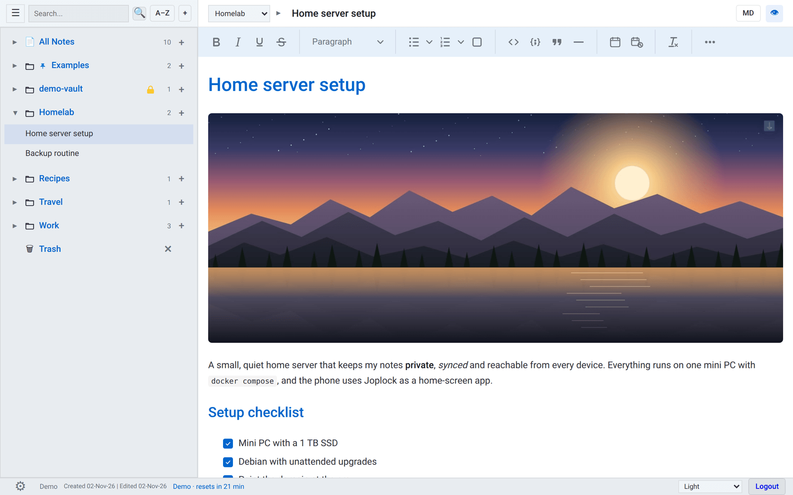
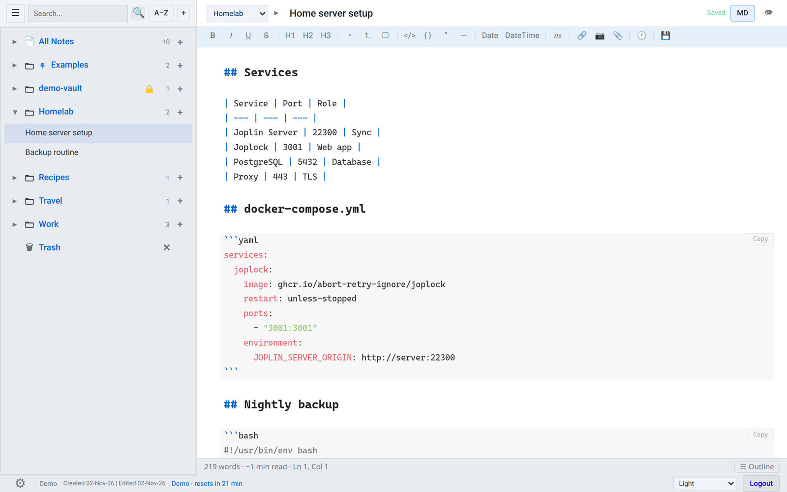
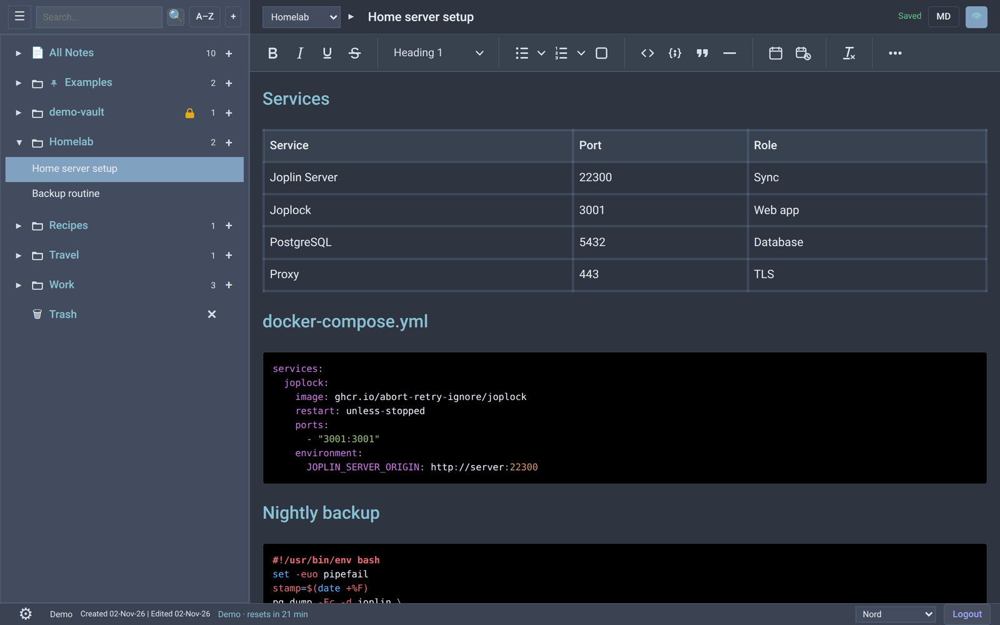
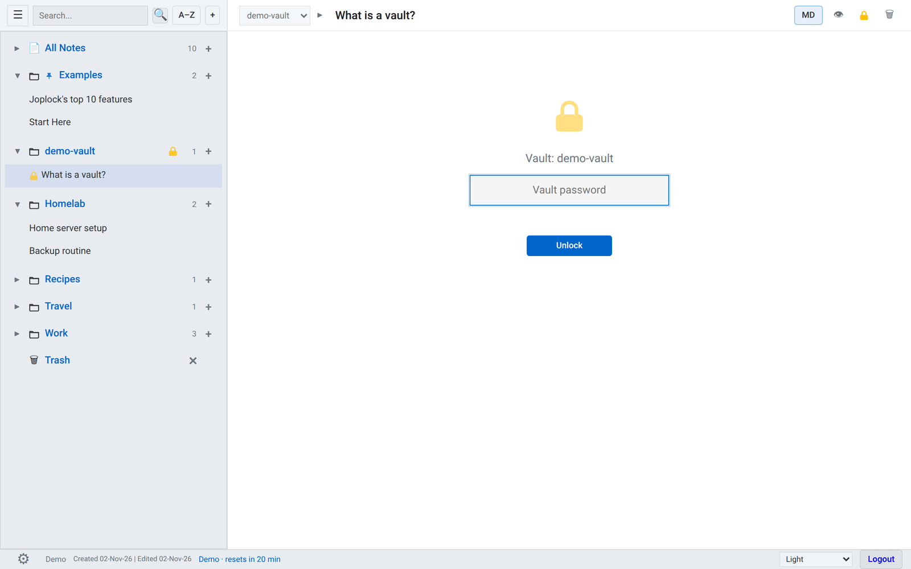
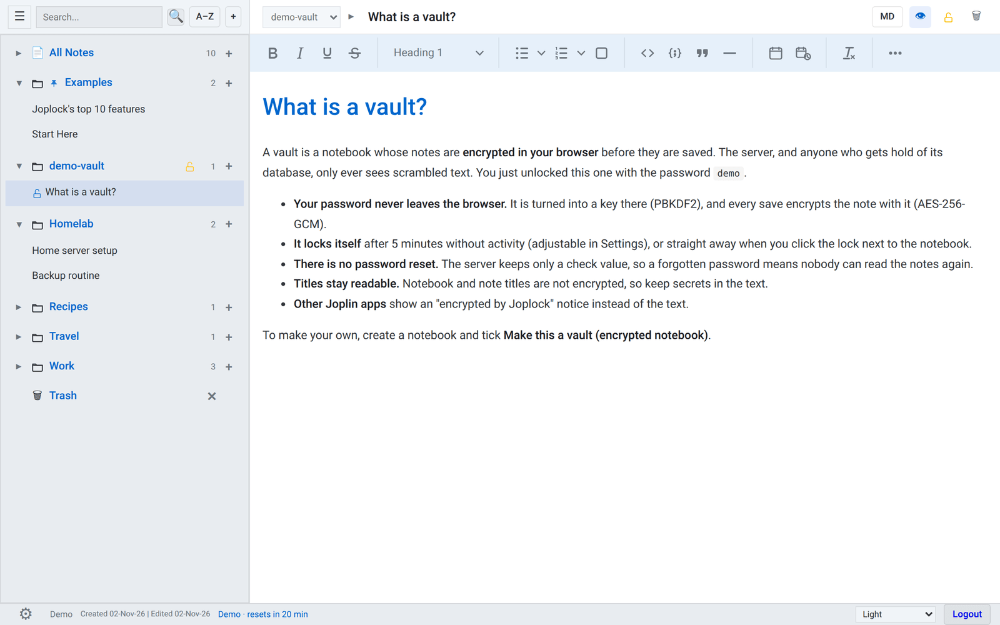
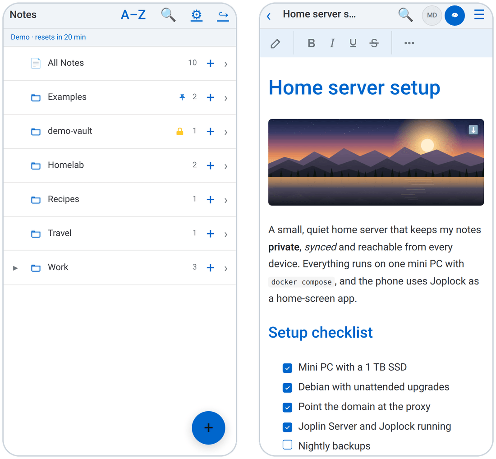

# Joplock

A secure, fast web client for [Joplin Server](https://github.com/laurent22/joplin).

**Try it: [joplock.bazooda.com](https://joplock.bazooda.com)**, login `demo`, password `demo` (details in [Live demo](#live-demo)).



Joplock runs as a sidecar alongside an unmodified Joplin Server instance, sharing the same Postgres database, sessions, notes, folders, and resources. It gives you a lightweight browser-based interface to your Joplin notes without modifying Joplin Server itself.  Keep using the other Joplin clients too, this won't interfere.

### Key Features

- **Full Joplin compatibility** -- desktop, mobile, CLI, and Joplock all work with the same account and data simultaneously
- **Nested notebooks** -- Joplin's notebook hierarchy as a tree on desktop and mobile: create sub-notebooks, move notebooks anywhere (the server refuses moves into their own descendants), and deleting a notebook promotes its sub-notebooks and notes instead of removing them
- **Notebook sharing** -- share a notebook (with all of its sub-notebooks) by email with per-recipient read/write access; the sharer keeps ownership, and vault notebooks cannot be shared
- **Low Resource usage** -- minimal memory usage on the client, fast and responsive
- **Security-first design** -- no private data stored on the client; sessions are cleaned up on logout; per-user settings and admin controls for user management
- **Client-side encrypted vaults** -- turn any notebook into a vault; notes inside are AES-GCM encrypted in the browser with a PBKDF2-derived key. The server never sees vault passwords. Ciphertext is bound to a specific vault and note id, and the server rejects any write that would land a vault-encrypted body in the wrong note or the wrong vault
- **Dual-mode editor** -- CodeMirror 6 for markdown editing (the default) and TinyMCE 8 for rich rendered mode, switchable per note; on the mobile layout (phones and narrow windows) rendered mode opens read-only with a pencil toggle to edit
- **Rich markdown mode** -- inline image previews with drag-to-resize, attachment and note-link chips with hover info, clickable task checkboxes, code-block Copy buttons, Tab-aligned pipe tables, paste-as-markdown (web pages, Word, Docs) and URL-over-selection links, heading folding, a word-count status bar with a heading outline (desktop layout only), and an optional live-preview mode that hides formatting marks off the line you are editing (each switchable under Settings → Markdown editor)
- **Tables, code blocks, and lightbox** -- full-screen code editor modal with language picker, TinyMCE tables with markdown round-trip, a lightbox for images and attachments, and a per-image download button
- **Note export** -- export any note as Markdown, single-file HTML (images and links inlined), DOCX (server-side via pandoc with reference styles), or PDF (pandoc + weasyprint), with visible table gridlines in PDF/DOCX output
- **AI autocomplete** -- optional prose completion via user-configured provider profiles (OpenRouter and others), triggered by Ctrl/Cmd-Space or configurable Expander triggers; a `/ask <question>` slash command for direct Q&A; per-user text expanders for snippets
- **Concurrent-edit detection** -- detects when another client (or another browser tab) has updated the same note and offers Overwrite / Create copy so edits are never silently lost
- **Multiple themes** -- 21 themes (Grey, Fruit, Dark Fruit, Earth, Swamp Thing, Fireball, Dracula, Nord, and more), all as CSS custom-property sets; per-user theme picker in the status bar and settings page
- **User creation from Joplock UI** -- create and modify users directly from Joplock settings page
- **Full database backup and restore** -- create and restore complete Postgres backups for both Joplin and Joplock data
- **Multi-factor authentication** -- optional TOTP-based MFA on top of standard Joplin sessions
- **Fast search** -- searches titles and note bodies directly in Postgres; optional live-as-you-type search
- **Near-instant autosave** -- debounced saves with conflict detection, hash-based deduplication, and an undo ring buffer with full note history snapshots. Restoring a snapshot updates the open editor immediately without a page refresh
- **PWA support** -- installable as a home screen app on mobile and desktop, with splash screens, a mobile layout that follows the phone in both orientations (display-cutout safe), and compressed, cached static assets. Notes are never stored offline: with no connection you get an offline page, not a cached note
- **Server-side rendering** -- SSR with htmx for minimal client-side JavaScript

## Live demo

**[joplock.bazooda.com](https://joplock.bazooda.com)**: sign in with `demo` / `demo`, or press **Try the demo**. No sign-up.

What is in it:

- **Example notebooks**: Homelab (a note with an image, checklists, a table, code blocks, an attachment and a link to another note), Recipes, Work with a nested Meetings notebook, and Travel.
- **demo-vault**: an encrypted vault. Unlock it with the password `demo` and the note inside is decrypted in your browser.
- **Joplock's top 10 features**, in the pinned Examples notebook.
- The light theme, with notes opening rendered. Press **MD** for the Markdown source, or pick one of the 21 themes in the status bar.

Good to know:

- **Everyone shares one account**, so you may see what other visitors did. Do not type anything private.
- **Everything resets every 30 minutes**, on the hour and at half past (UTC). The countdown in the status bar shows when.
- **Turned off in the demo**: changing the account (password, email, two-factor sign-in), AI features and sharing. Uploads are limited to 5 MB.
- It runs on one small ARM server with docker compose, behind Caddy for HTTPS. The whole setup, including the reset, is in [`deploy/demo/`](deploy/demo/README.md).

| Markdown editor | The same section rendered, Nord theme |
|---|---|
|  |  |
| **A vault, locked** | **Unlocked with its password** |
|  |  |

<p align="center"></p>

## Runtime Model

Joplock:
- reads Joplin data directly from the shared Postgres database
- validates the same `sessionId` cookie used by Joplin Server
- writes notes, folders, and resources through stock Joplin Server APIs

That keeps desktop, mobile, CLI, and Joplock compatible with the same account and data.

### Vault Safety With Sync Clients

Vault enforcement for desktop, mobile, and CLI writes only runs when their sync
traffic goes through Joplock's Joplin proxy. A direct public Joplin Server URL
bypasses that guard. Do not expose a direct Joplin Server endpoint to clients
that can access vault notebooks.

Use one public Joplock URL and proxy sync under a prefix, for example:

```text
JOPLOCK_PUBLIC_BASE_URL=https://notes.example.com
JOPLIN_PUBLIC_BASE_PATH=/joplin
JOPLIN_SERVER_PUBLIC_URL=https://notes.example.com/joplin
```

Set Joplin Server's `APP_BASE_URL` to that same public `/joplin` URL, route
clients to `https://notes.example.com/joplin`, and keep Joplin Server internal.
Joplock then rejects sync writes that would move a vault note, replace it with
plaintext, or put its ciphertext in a different note/vault.

## Requirements

- docker
- an existing Joplin Server instance, or run the fullstack option

The published image already contains everything the app shells out to:
`postgresql18-client` (backups), `pandoc` (DOCX/PDF export), and `weasyprint`
(PDF export).

## Environment

All configuration is done directly in the compose files via inline environment variables with comments. No `.env` file is needed -- just edit the values in `docker-compose.yml` or `docker-compose.example-full.yml` before starting.

Backup and recovery configuration:

- `JOPLOCK_BACKUP_DIR` enables server-side full database backups
- `JOPLOCK_BACKUP_COMPRESSION` controls the `pg_dump` compression method, for example `zstd:19` or `gzip:9`
- `JOPLOCK_BACKUP_COMPRESSION_LEVEL=0-9` controls `pg_dump` compression for backup files
- `JOPLOCK_RECOVERY_ENABLED=true` enables the break-glass recovery page at `/recovery`
- `JOPLOCK_RECOVERY_PASSWORD` protects that recovery page

Important:

- Backups are only durable if `JOPLOCK_BACKUP_DIR` is mounted to persistent storage.
- Default backup compression is `zstd:19`, which is usually smaller than `gzip:9`.
- `JOPLOCK_BACKUP_COMPRESSION` takes precedence over `JOPLOCK_BACKUP_COMPRESSION_LEVEL`.
- Higher compression produces smaller backup files but may take longer to create.
- Recovery mode is for backup and restore only, not regular note usage.
- Restore replaces the entire shared Postgres database, including Joplock-owned tables.

## Docker

Published container image:
- `ghcr.io/abort-retry-ignore/joplock:latest`

### Sidecar Install

Use this when you already have Joplin Server and Postgres running elsewhere. Edit the environment values in `docker-compose.yml` to point at your existing setup, or copy into your existing compose. Then:

```bash
docker compose up -d
```

This pulls the pre-built image from GitHub Container Registry. To build from source instead, use the full-stack build variant (Postgres + Joplin Server + Joplock, Joplock built locally):

```bash
docker compose -f docker-compose.example-full-build.yml up -d --build
```

On Linux, the compose files map `host.docker.internal` to the host gateway so Joplock can reach host services by default.

### Backup And Restore

Normal workflow:

1. Sign in as the configured Joplock admin.
2. Open `Settings -> Admin -> Backup & Restore`.
3. Create a backup or restore an existing server-side backup.

Break-glass workflow when normal Joplin login is unavailable:

1. Enable `JOPLOCK_RECOVERY_ENABLED=true` and set `JOPLOCK_RECOVERY_PASSWORD`.
2. Open `/recovery`.
3. Sign in with the recovery password.
4. Create or restore full database backups from there.

Before restoring:

1. Stop or quiesce Joplin Server if possible.
2. Stop active sync clients.
3. Expect the entire shared Postgres database to be replaced.

### Full Example Stack

Use this as a reference/demo stack with Postgres, Joplin Server, and Joplock together. Edit the values in `docker-compose.example-full.yml` as needed, then:

```bash
docker compose -f docker-compose.example-full.yml up -d
```

The full example uses the public `joplin/server:latest` image. Joplock is exposed on `http://localhost:5444` by default. Joplin Server is internal-only unless you add a port mapping.

The full example is meant as a working reference compose file. Adjust it for your real deployment.

### Development

`AGENTS.md` holds the repo rules, and `docs/agents/` the reasons and "do not regress" contracts by topic (it is written for coding agents, short and on-demand). `docs/joplock-db-schema.html` documents the
four sidecar tables Joplock adds to the shared database.

For local work, keep a git-ignored `docker-compose.dev.yml` (Postgres + Joplin
Server + Joplock from source) and rebuild the app container after source edits:

```bash
./scripts/rebuild-dev.sh
```

The Docker image copies `app/`, `public/`, and `server.js` at build time, so
`docker compose restart joplock` does not pick up source changes.

## License

Copyright (C) 2026 Igor Divjak

Joplock is free software: you can redistribute it and/or modify it under the terms of the
GNU Affero General Public License as published by the Free Software Foundation, either
version 3 of the License, or (at your option) any later version. See [`LICENSE`](./LICENSE).

Because Joplock is a network service, the AGPL also applies to people who use a modified
version over a network: if you run a modified Joplock for others, you must offer them the
source of your version (section 13). The About tab in Settings links to the source.

Joplock bundles third-party components under their own licenses (MIT, BSD, 0BSD, OFL, and
TinyMCE under GPL-2.0-or-later); see [`THIRD_PARTY_NOTICES.md`](./THIRD_PARTY_NOTICES.md).
